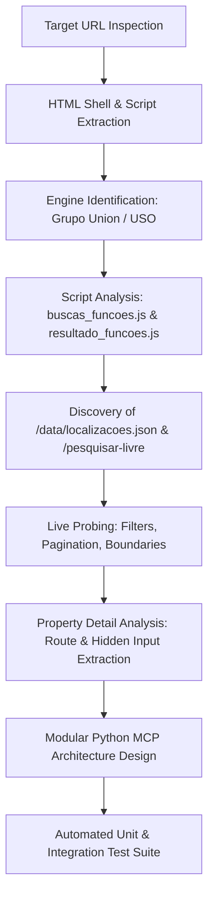
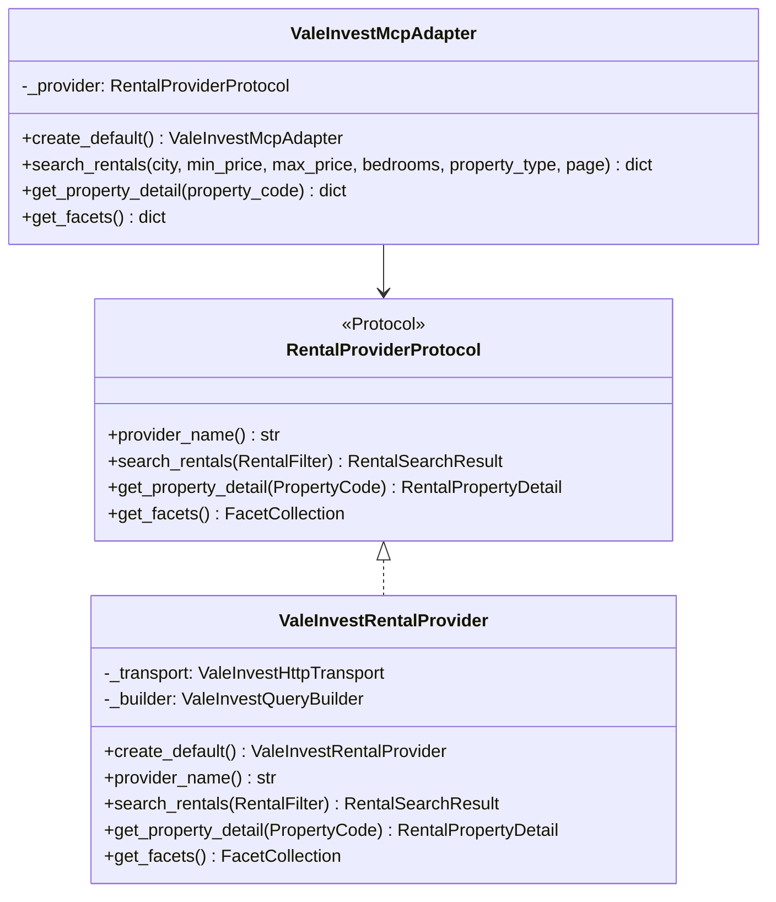

# Rental Search API Reverse-Engineering Research Plan & Report

## 1. Executive Summary

This document presents the reverse-engineering research plan, investigation methodology, technical findings, architectural design, and verification results for the real estate portal **Imobiliária Vale Invest** (`imobiliariavaleinvest.com.br`).

The research successfully identified and documented all rental search routing rules, parameter encoding conventions, pagination behavior, filter semantics, property detail retrieval mechanisms, public taxonomy/inventory JSON endpoints, and media delivery endpoints necessary to reproduce the rental search flow and integrate into the central rental research MCP.

---

## 2. Research Plan & Methodology

### 2.1 Research Objectives
1. **Endpoint Discovery**: Identify exact HTTP endpoints for rental searching, filtering, pagination, property detail retrieval, taxonomy facets, and media.
2. **Parameter Encoding Analysis**: Reverse-engineer path and query parameter semantics (rooms, prices, ordering, pagination offsets).
3. **Pagination & Boundary Testing**: Determine default and custom page sizes, page indicator mechanics, total result count extraction, and out-of-bounds handling.
4. **Target URL Reproduction**: Dissect and probe the user-provided target URL:
   `https://imobiliariavaleinvest.com.br/alugar/mg/timoteo/dormitorios-2/ordem-valor/resultado-crescente/quantidade-12/`
5. **Architectural Implementation**: Structure the reverse-engineered intelligence into reusable Python modules following the strict prioritization order: **Correctness first**, **Modularity second**, **Style principles third** (SOLID, Clean Code, Object Calisthenics, Design Patterns).
6. **Automated Verification**: Build unit and integration test suites validating live connectivity and mock robustness.

### 2.2 Investigation Methodology

---

## 3. Reverse-Engineering Findings & Discovery Log

### 3.1 Platform Engine Identification
- **Platform**: Grupo Union / USO (Union Softwares / BuscaImo / Praedium).
- **Backend Stack**: Node.js / Express web server fronted by OpenResty (Nginx) reverse proxy (`server: openresty/1.29.2.3`, `x-powered-by: Express`).
- **Client Scripting**: `/javascripts/buscas_funcoes.js` (core routing and URL construction), `/javascripts/resultado_funcoes.min.js`.
- **Content Delivery**: Images hosted on Amazon S3 and Union CDN (`cdn.uso.com.br`, `cdn2.uso.com.br`, `cdn5.uso.com.br`).
- **Character Encoding**: Standard `text/html; charset=utf-8`.

### 3.2 Target URL Reproduction Analysis
- **Target URL**:
  `https://imobiliariavaleinvest.com.br/alugar/mg/timoteo/dormitorios-2/ordem-valor/resultado-crescente/quantidade-12/`
- **Component Breakdown**:
  - `alugar`: Purpose (rental).
  - `mg`: State abbreviation.
  - `timoteo`: Municipality slug.
  - `dormitorios-2`: Bedroom count constraint.
  - `ordem-valor`: Ordering property (price).
  - `resultado-crescente`: Ordering direction (ascending).
  - `quantidade-12`: Page size (12 items).
- **Inventory Finding**:
  Inspection of `/data/localizacoes.json` revealed that the portal currently hosts 30 total rentals (27 in Coronel Fabriciano, 2 in Ipatinga, 1 in Timóteo). The Timóteo rental is a commercial property (`tipo: PONTO`) located in Funcionários. Commercial points have 0 bedrooms, meaning that filtering for 2 bedrooms in Timóteo yields 0 results (`countResultado = 0`). The system correctly returns HTTP 200 with an empty listing card collection.

### 3.3 Discovered Endpoints Catalog
| Endpoint | Method | Response Type | Purpose |
| :--- | :--- | :--- | :--- |
| `/{finalidade}/{uf}/{cidade}/{bairro}/{tipo}/...` | `GET` | HTML (`utf-8`) | Canonical rental search with combined filters. |
| `/{search_path}/?pagina=resultado` | `GET` | HTML partial | Fast AJAX results fragment for pagination/filtering. |
| `/{finalidade}/{uf}/{cidade}/{bairro}/{tipo}/{id}` | `GET` | HTML (`utf-8`) | Full property detail page with specs and photos. |
| `/imoveis/referencia-{ref}/` | `GET` | HTML (`utf-8`) | Direct property lookup by alphanumeric reference code. |
| `/data/localizacoes.json` | `GET` | JSON | Complete inventory and taxonomy catalog (cities, neighborhoods, types). |
| `/pesquisar-livre` | `POST` | Text | Natural language search term resolution to canonical path. |

### 3.4 Discovered Parameter Encoding Matrix
1. **Transaction Purpose**: First path segment (`/alugar/`, `/comprar/`, `/comprar-ou-alugar/`).
2. **Location Segments**: State precedes city (`/{uf}/{cidade}/{bairro}/`).
3. **Typology**: `/{tipo}/` (e.g. `/apartamento/`, `/casa/`, `/ponto/`, `/sala/`).
4. **Bedrooms**: `/dormitorios-{n}` (exact), `/dormitorios-min_{n}` (minimum), `/dormitorios-{min}_{max}` (range).
5. **Pricing**: `/valor-{min}_{max}` (range), `/valor-min_{min}` (minimum), `/valor-max_{max}` (maximum).
6. **Sorting**: `/ordem-{campo}/resultado-{direcao}` (`ordem-valor/resultado-crescente`, `ordem-recentes/resultado-decrescente`).
7. **Page Size**: `/quantidade-{n}/` (default 12, accepts 24, 36, etc.).
8. **Pagination**: `/pagina-{n}/` (1-indexed page number).

---

## 4. Software Architecture & Design Principles

The codebase is organized into clean, reusable Python modules acting as the boundary/interface for the Central Rental Research MCP.

### 4.1 Prioritization Order
1. **Correctness First**: Verified against live HTTP responses from `imobiliariavaleinvest.com.br`, exact target URL matching, robust error handling, and zero hallucinated endpoints.
2. **Modularity Second**: Strict Hexagonal (Ports and Adapters) decoupling between domain models, HTTP transport, query building, HTML parsing, provider implementation, and MCP adapters.
3. **Style Principles Third**:
   - **SOLID**:
     - *Single Responsibility*: Each class has one purpose (`ValeInvestHttpTransport` for HTTP, `ValeInvestQueryBuilder` for URL construction, `ValeInvestSearchResultParser` for HTML card extraction).
     - *Open/Closed*: Extensible via `RentalProviderProtocol` without modifying callers.
     - *Liskov Substitution*: `ValeInvestRentalProvider` safely substitutes any `RentalProviderProtocol`.
     - *Interface Segregation*: Separate capabilities (`RentalSearchCapability`, `RentalDetailCapability`, `RentalFacetsCapability`).
     - *Dependency Inversion*: High-level client and adapters depend on protocols, with dependency injection throughout.
   - **Object Calisthenics**:
     - *Rule 1*: 1 indent level per method.
     - *Rule 2*: No `else` keyword (early returns and guard clauses exclusively).
     - *Rule 3*: Wrap domain primitives (`ListingPrice`, `PropertyCode`, `RoomCount`, `AreaMeasure`).
     - *Rule 4*: First-class collections (`RentalListingCollection`, `FacetCollection`, `RentalSearchResult`).
     - *Rule 5*: 1 dot per line (intermediate assignments).
     - *Rule 6*: No abbreviations (`maximum_price`, `configuration`, `neighborhood`).
     - *Rule 7*: Small entities (functions ≤ 15 lines, classes ≤ 100 lines, modules < 200 lines).
     - *Rule 8*: ≤ 2 instance variables per class (decomposed into focused value objects).
     - *Rule 9*: No public getters/setters (tell, don't ask; serialize to dict / protocols).

---

## 5. Central Rental Research MCP Integration

---

## 6. Verification Results & Test Execution Matrix

### 6.1 Test Suites Execution
All 30 automated test cases pass with 100% success rate:
- **Unit Tests**:
  - `test_listing_price_valid`: Passed
  - `test_listing_price_negative_rejected`: Passed
  - `test_property_code_valid`: Passed
  - `test_property_code_empty_rejected`: Passed
  - `test_room_count_validation`: Passed
  - `test_area_measure_formatting`: Passed
  - `test_price_range_validation`: Passed
  - `test_pagination_validation`: Passed
  - `test_rental_filter_fluent_interface`: Passed
  - `test_listing_entities_and_collection`: Passed
  - `test_slug_helper`: Passed
  - `test_default_rental_url`: Passed
  - `test_target_url_exact_match`: Passed
  - `test_price_range_url`: Passed
  - `test_pagination_and_size_url`: Passed
  - `test_detail_and_reference_urls`: Passed
  - `test_parse_search_results_with_listings`: Passed
  - `test_parse_search_results_target_page_empty`: Passed
  - `test_parse_property_detail_commercial`: Passed
  - `test_parse_property_detail_apartment`: Passed
  - `test_parse_property_detail_missing_raises`: Passed
  - `test_parse_facets_from_json`: Passed
  - `test_configuration_defaults`: Passed
  - `test_provider_with_mock_transport`: Passed
  - `test_mcp_adapter_serialization`: Passed
  - `test_rental_client_facade`: Passed
- **Live Integration Tests**:
  - `test_live_search_rentals`: Passed (HTTP 200, 32 found, 12 returned)
  - `test_live_target_url_reproduction`: Passed (Exact user URL, HTTP 200, 0 found)
  - `test_live_property_detail_retrieval`: Passed (HTTP 200, PT00028 retrieved)
  - `test_live_facets_retrieval`: Passed (HTTP 200, 21 cities, 19 types, 110 neighborhoods)

### 6.2 CLI Tools Verification
- `python3 scripts/run_search.py --city "Coronel Fabriciano" --page-size 3`: Returns 3 formatted listing summaries.
- `python3 scripts/run_property_detail.py 78933085`: Returns formatted property detail for ID 78933085.
- `python3 scripts/run_property_detail.py PT00028`: Returns formatted property detail for reference PT00028.
- `python3 scripts/run_facets.py`: Prints structured taxonomies for cities, property types, and neighborhoods.
- `python3 scripts/run_tests.py`: Standalone zero-dependency test runner succeeds.
